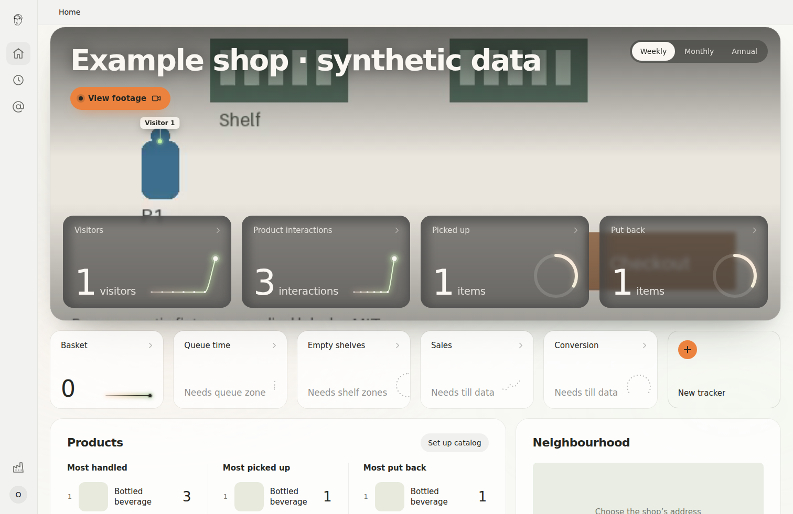

# Camera video search for retail teams

Search camera recordings, inspect the moments behind a result and compute retail trackers from admitted observations.

Originally **Rocoto Video**, built on the Vitrina Harness. This source beta includes the original retail interface, ingestion and indexing code, Cosmos adapters, source-scoped playback, observation admission, nine deterministic trackers and the shared agent workspace.



The native dashboard runs the supplied twelve-second recording and three authored annotations.

## Run the interface

Python 3.12. The included recording and annotations are authored synthetic fixtures.

```sh
git clone https://github.com/latintzar/camera-video-search.git
cd camera-video-search
make install
make dev
```

Open **http://127.0.0.1:18530**. Read the private `~/.local/state/video-operations/owner-code.txt` file and enter its one-use code. The starter creates your own workspace outside the checkout, processes the supplied annotations through the real admission/tracker pipeline and opens the original interface. Provider networking is disabled in this starter.


[Getting started](docs/get-started.md) · [Workflows](docs/workflows.md) · [Architecture](docs/video-architecture.md) · [Setup](docs/video-setup.md) · [Design decisions](docs/video-design.md) · [Function reference](docs/video-reference.md)

## Included work

| Layer | Implementation | Evidence |
| --- | --- | --- |
| Interface | Home, tracker canvases, camera player, visitor chapters, onboarding and workspace | Source-built local walkthrough with authored records |
| Sources | Resumable upload, link/folder/SFTP intake, immutable versions, preparation and worker readiness | Offline protocol tests; connected services have separate commissioning |
| Semantic index | Cosmos Embed on H100, exported CPU text tower, persistent Qdrant generations | Original executed trials and retained code; current release checks use local fixtures/fake transports |
| Detailed inspection | Selected-clip Cosmos inspection, caching, evidence derivation and bounded compute | Original paid trials; fresh provider acceptance remains separate |
| Observations and trackers | Clock/identity admission, provenance, baskets, nine core processors, typed tile/canvas output | Durable synthetic first result and source tests |
| Shared workspace | Accounts, conversations, agents, recipes, tools, permissions and spending | Included Vitrina Harness implementation; managed execution uses a recipient OpenAI project |

The starter's three labels are supplied annotations. GPU/model execution, production camera acquisition, POS delivery and business-event accuracy have their own acceptance paths. [Status and historical trials](docs/video-status.md).

## Original launch artwork


Fictional, AI-generated launch scenes. [Artwork provenance](provenance/marketing-assets.json).

## Continue the work

```sh
make test
python tools/source-map.py
```

Each guide links the actual implementation and records its boundary. The [agent setup skill](.agents/skills/video-operations-setup/SKILL.md) follows the same path. Keep recipient credentials and state outside source through [the configuration helper](docs/video-setup.md).

Original code and authored fixtures use [MIT](LICENSE). Vendored libraries, fonts, model weights and marks retain their [own terms](THIRD_PARTY.md). Historical operating receipts, source footage and customer state stay with their owners.

[made by atelier neyra](https://atelierneyra.com)
