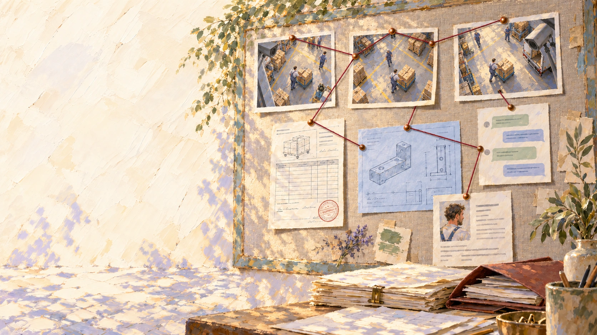

# Implementation and retained evidence

This guide retains the implementation layers, sample evidence, original launch artwork and continuation commands from public source `b1d1dbaafd59cd9754bbf90ae4d98d55e6e72049`. The [product tour](product-tour.md) explains the dashboard experience first. [Trial status](video-status.md) records the dated executed runs and remaining acceptance.

## Included work

Originally **Rocoto Video**, built on the Vitrina Harness. This source beta includes the original retail interface, ingestion and indexing code, Cosmos adapters, source-scoped playback, observation admission, nine deterministic trackers and the shared agent workspace.

| Layer | Implementation | Evidence |
| --- | --- | --- |
| Interface | Home, tracker canvases, camera player, visitor chapters, onboarding and workspace | Original UI over the retained processed sample |
| Sources | Resumable upload, link/folder/SFTP intake, immutable versions, preparation and worker readiness | Offline protocol tests; connected services have separate configuration and acceptance checks |
| Semantic index | Cosmos Embed on H100, exported CPU text tower, persistent Qdrant generations | Original executed trials and retained code; current release checks use local fixtures/fake transports |
| Detailed inspection | Selected-clip Cosmos inspection, caching, evidence derivation and bounded compute | Original paid trials; fresh provider acceptance remains separate |
| Observations and trackers | Clock/identity admission, provenance, baskets, nine core processors, typed tile/canvas output | Retained model answers, publisher references, generated history and source tests |
| Shared workspace | Accounts, conversations, agents, recipes, tools, permissions and spending | Included Vitrina Harness implementation; managed execution uses your own OpenAI project |

The sample preserves nine recordings with archived model answers, including four views from the latest completed trial. That trial produced 17 quarantined observations. Publisher annotations and generated business history retain their own provenance. [Sample guide](processed-sample.md) · [Status and historical trials](video-status.md).

## Original launch artwork



Fictional, AI-generated launch scenes. [Artwork provenance](../provenance/marketing-assets.json).

## Continue the work

```sh
make test
python tools/source-map.py
```

Each guide links the actual implementation and records its boundary. The [agent setup skill](../.agents/skills/video-operations-setup/SKILL.md) follows the same path. Keep your credentials and state outside source through [the configuration helper](video-setup.md).

Original code and authored fixtures use [MIT](../LICENSE). Vendored libraries, fonts, model weights and marks retain their [own terms](../THIRD_PARTY.md). The downloadable retail sample carries the Standard.AI Dataset License and CC BY-SA 4.0 separately; its full terms and attribution travel with the files.

[made by atelier neyra](https://atelierneyra.com)
