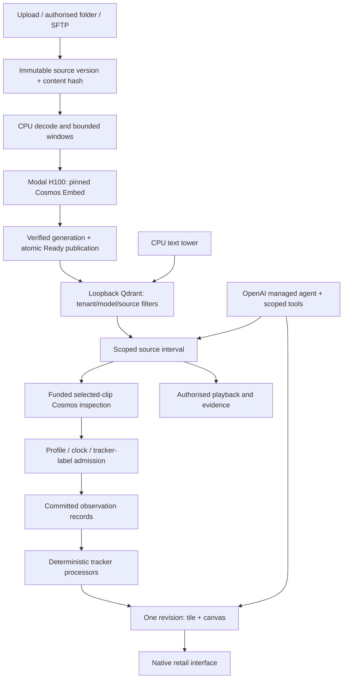

# Architecture

## Shared workspace

The [HTTP host](../harness/server.py) mounts the selected vertical and its shared workspace services.

`harness/runtime`, `mechanics`, `sdk` and `web` provide identity, persistent conversations, tools, jobs, role delegation, files, approvals and spending. `harness/verticals/retail` supplies this product's vocabulary, host hooks, sources, observations, trackers and interface. [Framework guide](../harness/README.md).

## Source and index

`source_intake.py` owns durable intake state. `source_worker.py` advances preparation, embedding and verified publication. `source_service.py` commissions that worker separately; the web host checks its exact readiness receipt and heartbeat.

`modal_embed.py` pins the image/text embedding space. `cosmos_retrieval.py` retains complete-coverage arrays and generation identity. `qdrant_retrieval.py` adds persistent, filtered retrieval with concrete generation snapshots and atomic aliases. `source_visibility.py` filters the visible index to sources whose Ready state actually committed.

## Observation hierarchy

The hierarchy is **company → location → camera → recording → tracked visitor → observation**. Recording identity includes bytes and clock mapping. Person IDs are local to their recording/camera; a label does not establish a person's identity across arbitrary cameras.

`stream_ingestion.py` validates observation profiles, finite source windows, labels and receipts. `retail_records.py` derives observed items, baskets, shelf states, queue intervals and estimated sales. `core_trackers` computes maintained outputs. A till transaction and a basket estimate keep different bases.

## Playback and evidence

`control_room_routes.py` serves authenticated, source-scoped published bundles. `playback_media.py` joins sealed bytes to the maintained reader's source/epoch/mapping identities. Permission checks recur while streaming; unavailable authority releases the picture. The browser's player, visitor chapters and Home use the same published records.

## Data stores

The first result uses private SQLite/file stores. The optional maintained realtime reader has its own PostgreSQL migration and SDK closure under `backend/`, with the existing `RUNTIME_DATABASE_URL` contract and tenant/principal RLS context. Qdrant stores vectors and source metadata separately. Cosmos checkpoints and customer recordings remain external runtime data.

[made by atelier neyra](https://atelierneyra.com)
